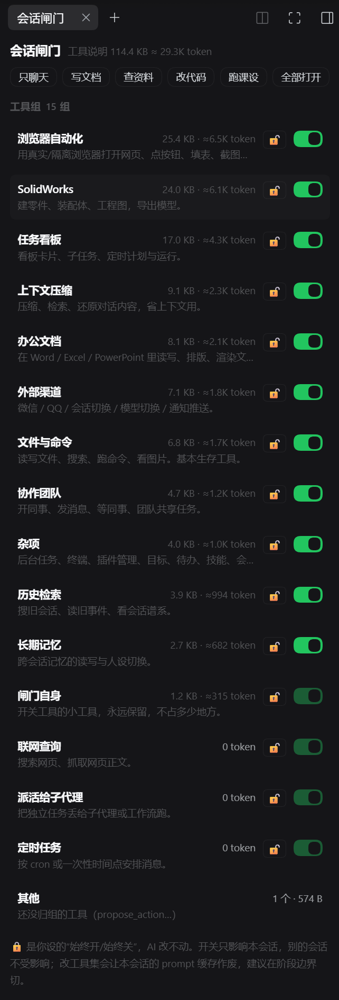
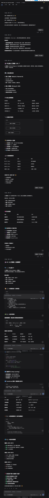

# dsh-session-gate

> DeepSeek Harness（DSH）的**会话级工具闸门 + 本地小模型预设**。
> Per-session tool gate + local-model preset for DeepSeek Harness — hide the tool manuals a session doesn't need, save context.

---

## 这是什么

本地小模型（比如 Qwen3.5 4B，32K 上下文）跑 DSH 时，光是 152 个工具的“说明书”就要吃掉约 **34.9K token**，占掉大半个窗口，问两句就满。

这个插件不卸载任何插件，而是**按会话把工具的说明书从模型眼前移开**——`tools.restrict()` 会同时管住 schema、工具查找和执行层，省上下文的效果接近真卸载。配合右侧栏面板，可以随时开关、加锁、套配方。

## 功能

- **右侧栏「会话闸门」面板**：16 个工具组，显示字节数与 token 估算，逐组开关；🔒 人工锁**按会话隔离**（AI 改不动，拒绝时给理由）；6 个配方（只聊天 / 写文档 / 查资料 / 改代码 / 跑课设 / 全部打开）；底部显示“已省 X token（Y%）”。
- **agent 工具**：
  - `gate_status` — 列出本会话的工具组状态（只读）
  - `gate_switch` — 开关组：`{"groups":{"ego":false}}`、`{"all":true}` 或 `{"recipe":"chat"}`
  - `gate_plan` — 给它一句任务描述，推荐该开哪些组（只建议，不执行）
- **`local` 本地模式预设**：新建会话时选它，只挂最小工具集（persona + 文件读写 + Shell + 待办/提问 + 压缩），实测 Qwen3.5 4B 首轮 **13.5K / 32K（≈42%）**，长篇回答正常。
- **持久化**：状态存在 `~/.dsh/session-gate/`（`groups.json` 组表、`sessions.json` 每会话开关、`locks.json` 人工锁）。

## 快速开始

1. 在 DSH 里安装（把路径换成你 clone 下来的 `host` 目录）：

   ```
   plugin_manager install_bundle target=<本仓库路径>\host
   ```

2. 重载插件（改过代码时也一样）：

   ```
   plugin_manager set_bundle target=dsh-session-gate
   ```

3. 打开右侧栏 → **会话闸门** 页签，点配方或逐组开关。
4. 想要本地小模型模式：新建会话时在预设里选 **本地模式**。

## 工具用法示例

```jsonc
// 看状态
gate_status

// 关掉浏览器和办公文档两组
gate_switch {"groups": {"ego": false, "office": false}}

// 套用「只聊天」配方
gate_switch {"recipe": "chat"}

// 让插件推荐（不执行）
gate_plan {"task": "帮我用 Word 写一份机械课设报告，最后排版导出"}
```

## 界面

| 会话闸门面板 | 本地模式（Qwen3.5 4B，首轮 13.5K/32K） |
| --- | --- |
|  |  |

## 目录结构

```
host/                插件本体（Host 端 index.js + 浏览器端 client.js + cordis.patch.yml）
├─ cordis.patch.yml  挂载：插件行 + local 预设行
├─ index.js          gate_status / gate_switch / gate_plan、分组、锁、HTTP API
├─ client.js         右侧栏面板
├─ locale/           中英文展示名与描述
└─ README.md         插件详细文档（配置项、权限模型、状态文件格式）
tests/               smoke.mjs（全流程）+ recovery.mjs（跨重启 11 项断言）
docs/                截图
stage0~3-report.md   分阶段开发与实测报告（含数字与踩坑）
```

## 已知边界

- 只裁**工具说明书**，裁不了系统提示词和技能目录；小模型剩下的上下文主要是这些。
- 切换工具集会改变请求前缀 → **prompt 缓存作废**，所以建议在阶段边界切，别每轮都动。
- 不真卸载插件，所以不省内存和启动时间。
- 只裁继承/全局工具，agent 自己注册的 scope 内工具不受影响。
- 尺寸是进程内缓存，插件热重载后首次显示 0 KB 属正常，切一次组即恢复。

## 许可

MIT © 2026 **LumenLiu**（GitHub: [@Yan-Congliu](https://github.com/Yan-Congliu)）
