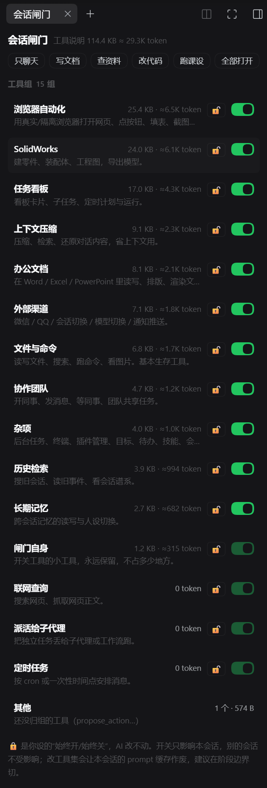
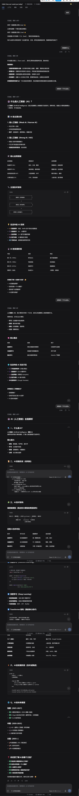

# 会话闸门 dsh-session-gate

给每个会话单独决定"这批工具要不要显示给模型"。不用的工具不再把说明书塞进请求，
本地小模型最宝贵的上下文就省下来了。只影响开闸门的那个会话，别的会话照旧。

- 阶段 0（已完成）：证明可行 —— 151 个工具 = 139,616 字节 ≈ 34.9K token，隐藏后确实从模型眼里消失。
  报告见 [`../stage0-report.md`](../stage0-report.md)。
- 阶段 1（已完成）：每会话开关 + 人工锁 + 持久化 + `gate_status` / `gate_switch` 两个工具。
- 阶段 2（已完成，0.2.x）：右侧栏面板（可视化）、6 个配方、`local` 本地模式预设。
- 阶段 3（部分完成）：与 billion-context 联调通过（各管一段，互不干扰）；重启恢复用跨进程模拟测试
  `tests/recovery.mjs` 验证（真机重启后查 `gate.log` 的 `agent/created … source=resume` 即完成最后一步）。
- 0.3.x：`gate_plan` 按任务描述推荐组合（关键词规则 + 配方 + 加项），只建议、不自动执行。
- 0.3.3：新增「待办与提问」组（`assist` = `todo_write` + `ask_user_question`，约 2.3 KB ≈ 0.57K token，
  可关）；`local` 预设默认挂上这两个工具；面板「已省」带百分比。
- 0.3.4：不再在 `cordis.patch.yml` 里写死本机路径 —— 状态目录默认 `$DSH_HOME/session-gate`，日志默认
  同目录 `gate.log`。仓库拿到别的机器上直接能装。
- 0.3.5：包名从 `@local/dsh-session-gate` 改为 `dsh-session-gate`（去掉私有域，公开分发更直观）。

## 装在哪、怎么装

`host/` 本身就是一个 bundle 目录，安装时把**绝对路径**交给 `plugin_manager`：

```
plugin_manager action=install_bundle target=<本仓库路径>\host
```

Windows 上路径形如 `D:\code\dsh-session-gate\host`；用反斜杠、不要加引号。装进当前 profile 后所有会话都会多出 `gate_status` / `gate_switch` / `gate_plan` 三个工具（合计约 0.94 KB ≈ 236 token）。

装完不需要重启；改完磁盘上的代码要重载：`plugin_manager action=set_plugin target=include:session-gate`
（先 `enabled:false` 再 `enabled:true`），整包重读则用 `set_bundle target=dsh-session-gate`。

### 手工安装（没有 `plugin_manager` 时）

有些桌面版不带 `plugin_manager` 工具，插件中心也只收 npm 包名。这时用仓库根的安装器：

```
node install.mjs            # dry run：只打印会改什么
node install.mjs --apply    # 真正写入
```

它做的事与下面手工步骤完全相同；想自己来就照着走（`<profile>` 一般是 `desktop`）：

1. 找到 DSH_HOME：默认 `C:\Users\<你的用户名>\.dsh`，设了环境变量 `DSH_HOME` 就用它。
2. 把本 `host/` 整个目录拷到 `<DSH_HOME>\plugins\dsh-session-gate`（没有 `plugins` 就新建）。
3. 再把 `host/` 拷到 `<DSH_HOME>\profiles\<profile>\node_modules\dsh-session-gate`（已有旧的就先删）。
4. 备份 `<DSH_HOME>\profiles\<profile>\package.json`。
5. 编辑它：`dependencies` 里加 `"dsh-session-gate": "file:<本仓库绝对路径>/host"`，
   `dsh.profile.bundles` 数组里追加 `"dsh-session-gate"`。
6. 重启 DSH。
7. 撤销：恢复第 4 步的备份，删掉第 2、3 步的两个目录，再重启。

装了之后可以用 `gate_status` 核对：0.3.6 起它会带 `stateDir` 与 `bundleVersion`，报 issue 时一并贴出来最快。

## 面板在哪

右侧栏 →「会话闸门」页签（需要先把右侧栏打开）。面板内容：

- 顶部：本会话短 id（如 `a1b2c3d4`，确认你在操作哪个会话）+ 工具说明共多少 KB / 多少 token + 已经省了多少（0.3.3 起带百分比，如 `已省 ≈3.9K token（25%）`）。
- 配方一排：只聊天 / 写文档 / 查资料 / 改代码 / 跑课设 / 全部打开 —— 点一下按配方批量开关。
- 每组一行：组名 + 一句话功能 + 字节/token + 🔓锁 + 开关。占 0 token 的组自动置底、开关置灰；
  如果这组工具在本会话里根本没加载（比如 `local` 预设不带），会写「本会话没装」，那不是省下来的。
- 底部提示：开关只影响本会话；改工具集会作废本会话 prompt 缓存。



`local` 本地模式在 4b 上的实际样子（工具说明约 2.7K token，首轮上下文 13.5K/32K ≈ 42%）：



面板通过回环地址的 `/session-gate/api`（`state` / `switch` / `lock` / `plan` / `sessions`）和 Host 说话，
和 `gate_switch` 工具走同一个 `applySwitch`，规则只实现一遍。

- `GET state?session=<id>` 也可以写 `?sessionId=<id>`（只当输入别名，返回字段仍叫 `sessionId`）。
- 不带 session、且**只有一个**会话在跑时，`state` 会用它并在响应里标 `fallback: true`；
  多个会话同时跑则回 `offline` + `sessions[]` 让你挑，不会自己乱猜。
- `switch` / `lock` / `plan` 这类写操作**从不兜底**：缺 session 或会话不在跑就报错 + 给候选列表，
  因为面板可能挂在一个休眠会话上，而此刻唯一活着的是另一个会话。

## 三层权限（下低上高）

| 层 | 谁写 | 位置 | 语义 |
|---|---|---|---|
| 人工锁 | **只有人**（面板 🔓 按钮），插件只在人点按钮时写 | `locks.json` | `"on"` 永远显示 / `"off"` 永远隐藏，agent 改不动；**只在本会话有效** |
| 会话选择 | `gate_switch` 工具 / 面板开关 | `sessions.json` | 仅本会话生效，按会话 id 持久化 |
| 默认 | 人（组表） | `groups.json` | 组自带的 `defaultOn` |

判定顺序：**人工锁 > 会话选择 > 默认**。被锁的组，agent 去切会拿到 `refused` 和原因。
锁和会话选择一样**按会话 id 分开存**：在一个会话里点 🔒，别的会话完全不受影响。

状态文件默认在 `$DSH_HOME/session-gate/`（Windows 通常是 `C:\Users\<你>\.dsh\session-gate\`；没设
`DSH_HOME` 时退回 `~/.dsh/session-gate`），日志默认写同目录下的 `gate.log`。想换位置，在
`cordis.patch.yml` 的 `session-gate` 行加 `config: {stateDir: '<路径>'}` 即可，不需要改代码：

- `groups.json` —— 纯数据组表：`id`、`name`、`description`、`names`、`prefixes`、`switchable`、
  `risky`、`defaultOn`、`countsContext`。首次启动自动生成，之后随便改，即时生效。
- `locks.json` —— 人工锁，按会话：`{"sessions": {"session-xxx": {"groups": {"ego": "off", "web": "on"}}}}`。
  旧版的全局 `{"groups": {...}}` 会在启动时改名成 `locks.legacy-<时间戳>.json` 留档，不再作用于任何会话。
- `sessions.json` —— 插件自动维护，别手改。

## 三个工具（agent 用）

- `gate_status` —— 所有组的开关/锁/工具数/字节/token，本会话总计与已省。
- `gate_switch` —— `{"groups": {"ego": false}}`、`{"all": true}` 或 `{"recipe": "research"}`。
- `gate_plan` —— `{"task": "写一份课设报告"}`：按关键词选配方、补上任务点名的组，
  返回建议的 `switch` 对象 + 预计可见字节/省下字节。**只建议，不自动执行**；锁住的组不动。

三个工具的说明书合计约 0.94 KB ≈ 236 token（0.2.3 压缩前约 1.2 KB ≈ 315）。

`gate_plan` 的规则是数据：`index.js` 里的 `PLAN_RULES`（任务类型 → 配方）与 `ADDON_RULES`
（关键词 → 追加组）。想加词、改配方，只改这两张表；`tests/smoke.mjs` 有对应断言。

## 配方

| id | 名称 | 打开的组 |
|---|---|---|
| chat | 只聊天 | gate, memory, misc, assist |
| docs | 写文档 | gate, files, office, memory, misc, assist |
| research | 查资料 | gate, web, ego, files, memory, misc, assist |
| code | 改代码 | gate, files, context, memory, misc, assist |
| course | 跑课设 | gate, files, solidworks, board, memory, misc, assist |
| all | 全部打开 | 全部 |

## `local` 本地模式（预设）

`cordis.patch.yml` 第二行声明了预设 `local`（显示名「本地模式」），新建会话时可选。
它只挂：persona（短前缀）+ tool-fs（读/写/编辑，不含看图）+ tool-pwsh + **tool-ask-user + tool-todo**
（0.3.3 起：遇事先问你、会话顶部待办清单）+ 压缩组（compaction-basic + command-compact +
tool-result-pruner）。不挂联网、办公、SolidWorks、子代理、技能目录 —— 那些提示词段落因此整段不出现，
比单用闸门更省。这两个小工具在闸门里单独成一组「待办与提问」（id `assist`，约 2.3 KB ≈ 0.57K token），
不想要可以在面板里关掉。

想改最小集：改 `index.js` 同目录的 `cordis.patch.yml` 里 `preset-local` 的 `plugins`，然后
`set_bundle` 关再开让 Loader 重读。预设与闸门互不依赖：只用预设不装闸门也行，只用闸门不选预设也行。

## 代价（重要）

显示/隐藏工具会改变请求前缀，**本会话的 prompt 缓存会整体作废**，下一轮重新计费。
所以：会话开头定好，或任务阶段切换时再动，别每轮切。

## 已知边界

- 只裁"全局注册"的工具；某个插件挂在 agent 作用域上的工具裁不到。
- 只裁工具说明书，裁不掉别的插件注入的提示词段落（那部分靠 `local` 预设少挂插件）。
- 插件启动后新注册的工具不会自动进闸门，要等下一次 `gate_status` / `gate_switch` 重算。
- 重载插件会重建尺寸缓存：隐藏中的组可能先显示 0 KB，切换一次即恢复。0.3.1 起，旧模块留下的
  屏蔽会在下次加载时自动释放（`agent.__sessionGateDispose` 标记）；更早版本重载后可能少测一组，
  重启应用或再重载一次即恢复。
- 隐藏后在执行层也会被拒（`tools.restrict` 同时管 schema、查找和执行），不是"藏起来骗模型"。
- 面板只对**正在运行**的会话生效；休眠会话切过去再操作。
- 面板拿不到 `props.sessionId` 时（0.3.6 起）不再空白：会列出正在跑的会话让人点一个接上；
  接上的是哪个会话，顶部会写「接上的会话 xxxx」。
- Host 重启后第一次读状态，已省字节可能先显示 0（尺寸缓存是进程内的），开关一次即恢复。
- 冷启动时插件可能比 web 服务先加载（0.3.2 前会记 `webServer unavailable` 并永久禁用面板 API，
  面板报「连不上闸门服务」）。0.3.2 起改用 `ctx.inject(['webServer'], …)` 等它就绪再注册。

## 版本历史

- 0.3.6 手工安装器 `install.mjs` + README 手工步骤；`/state` 支持 `sessionId` 别名与单活会话只读兜底；
  `/sessions` 与 `state` 带 `version`；`gate_status` 带 `stateDir` / `bundleVersion`；
  面板无会话时列候选；client 拿不到槽位打 `console.warn`；新增 `tests/api.mjs`。
- 0.3.5 包名去私有域（`@local/` → `dsh-session-gate`）。
- 0.3.3 待办/提问独立成组 `assist`，`local` 预设挂 `tool-todo` / `tool-ask-user`，面板显示已省百分比。
- 0.3.2 冷启动用 `ctx.inject(['webServer'], …)` 等网页服务，修复面板 API 不注册。

## 自测

```
node tests\smoke.mjs      # 工具开关全流程
node tests\recovery.mjs   # 跨重启恢复（11 项断言）
node tests\api.mjs        # HTTP API 契约（别名、兜底、写操作拒绝、版本）
```

假 tools 服务上跑完整流程：初始全开 → 隐藏 ego/web → 校验 deny 与持久化 → 人工锁挡 agent →
resume 重放 → 全开复原 → 「藏 A、再藏 B、只开 B 后 A 仍隐藏」回归。

## 文件

```
host/
  package.json        bundle 清单（dsh.bundle.patch + dsh.client）
  cordis.patch.yml    Loader 行：session-gate 插件 + preset-local 预设
  index.js            Host 侧：组表、测量、restrict、三工具、HTTP API、agent/created 重放
  client.js           右侧栏页签（React，无构建）
  locale/{zh,en}.json 插件商店展示用
  icon.svg            原创图标
  README.md           本文件
tests/smoke.mjs       离线自测
tests/recovery.mjs    跨进程重启恢复测试
tests/api.mjs         HTTP API 契约测试（假 webServer）
install.mjs           无 plugin_manager 时的安装器（仓库根，默认 dry run）
docs/                 面板与实测截图（README 引用）
stage0~3-report.md    阶段报告（开发记录）
LICENSE               MIT
```

## 改动接口（给以后留的路）

- 组表是纯数据，改 `groups.json` 即时生效；默认组表改 `index.js` 的 `DEFAULT_GROUPS`。
- 新配方：往 `index.js` 的 `RECIPES` 加一条（`groups: null` 表示全开）。
- 新面板功能：`gateApi` 里加方法、`client.js` 里加按钮，两边共用 `applySwitch` / `setLock`。
- 想动"裁什么"的策略：只改 `planFor` 的 deny 计算，不动 UI。

## 许可

MIT，见仓库根目录 [`../LICENSE`](../LICENSE)。
